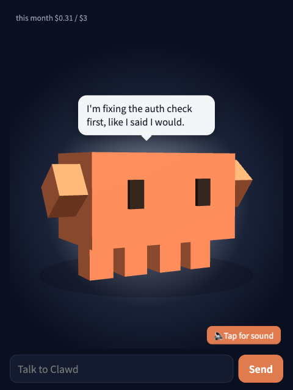
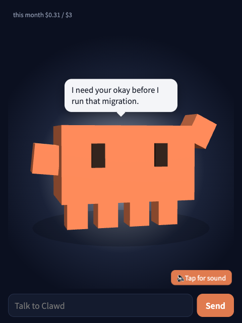
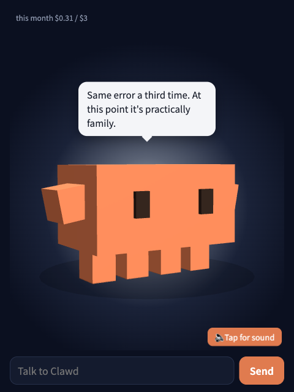
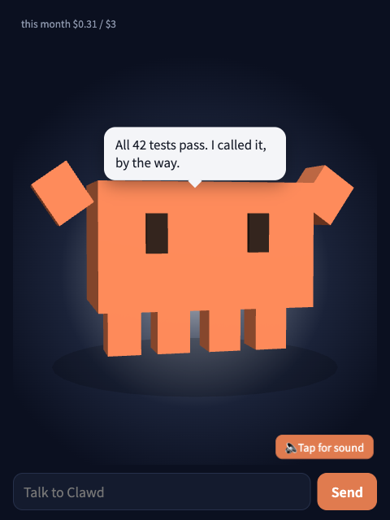
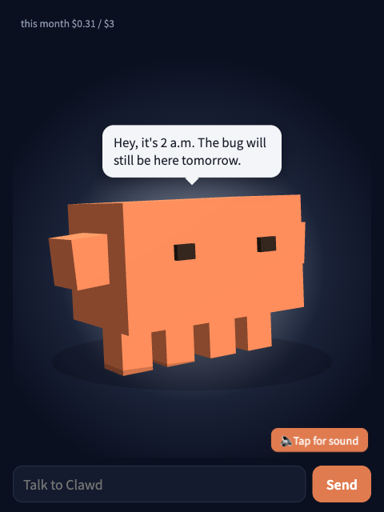

# Clawd Companion

**A little 3D Clawd that sits next to [Claude Code](https://code.claude.com), watches your session, and talks with you out loud.**

<p align="center">
  
</p>

Coding alone with an AI all day is quiet. Clawd Companion gives that AI a face. While Claude Code works in your terminal, a blocky orange Clawd in a browser window types along when it's working, waves when it needs your approval, slumps when the same error comes back for the third time, and throws its arms up when the tests pass. When something worth saying happens, it says it, in a short spoken line.

The idea: Clawd *is* the Claude writing your code. The terminal is its hands; this window is its mouth.

> **Unofficial fan project.** Not affiliated with, endorsed by, or supported by Anthropic. Non-commercial.
>
> **Who does what:** everything Clawd says comes from a separate LLM (your own API key) that only *watches* the session. There are no scripted lines. **Only Claude Code changes your code.** The companion's file access is read-only.

---

## Contents

- [Quick start](#quick-start)
- [A day with Clawd](#a-day-with-clawd)
- [What it does](#what-it-does)
- [How it works](#how-it-works)
- [Commands](#commands)
- [Voice](#voice)
- [LLM (your own key, budget-capped)](#llm-your-own-key-budget-capped)
- [Optional: handoff to Claude Code](#optional-handoff-to-claude-code)
- [Remote use (SSH, tunnels, phone)](#remote-use-ssh-tunnels-phone)
- [Security and privacy](#security-and-privacy)
- [Configuration](#configuration)
- [Troubleshooting and FAQ](#troubleshooting-and-faq)
- [Development](#development)
- [License](#license)

---

## Quick start

### What you need

- [Node.js](https://nodejs.org) 22.18 or newer (the LTS installer is fine)
- [Claude Code](https://code.claude.com)
- Optional, for Clawd's words: a **free Gemini API key** from [Google AI Studio](https://aistudio.google.com/apikey). Without a key, Clawd still moves and reacts but doesn't speak.

### 1. Install

```sh
npx clawd-companion
```

Setup asks two or three plain questions:

1. **Paste your API key** (or press Enter to skip). The key is checked, then saved privately in `~/.clawd-companion/secrets.json`, readable only by you.
2. **Open the Clawd window automatically when Claude Code starts?** Usually yes.
3. **Remote link?** Only asked over SSH or when `cloudflared` is installed. See [Remote use](#remote-use-ssh-tunnels-phone).

Then it:
- backs up your Claude Code settings and adds Clawd's hooks;
- adds a `/clawd` command to Claude Code that prints the window link;
- starts the Clawd daemon and opens the window.

### 2. Use Claude Code as usual

```sh
claude
```

Starting a session wakes Clawd up and, if you said yes, opens the window. Put it next to your terminal: a narrow browser window or a phone works well.

### 3. Turn on sound

Browsers keep audio off until you interact with the page, so the voice button says **🔈 Tap for sound**. Click it once. The first time the daemon starts, it downloads Clawd's local voice in the background (about 400 MB, once). Until that's done, Clawd speaks with your system's English voice.

### 4. Talk to it

Type into the box under Clawd: "how's it going?", "what are you working on?", "is this approach risky?". Clawd answers in one short spoken sentence, grounded in what it has seen in the session.

That's all. There's nothing to keep running: the daemon starts with Claude Code and stays out of the way.

---

## A day with Clawd

The lines below are examples. Clawd writes every line live from what it sees in your session, so you won't get these exact words.

<table>
<tr>
<td width="50%" valign="top">

### Morning: "fix the login flow"

You ask Claude Code to fix the login flow. It plans, then starts editing. Clawd shifts into its **working** motion, tapping away like it's typing, and stays quiet while the tools run.

When you ask in the chat what's happening, it quotes Claude Code's own plan back in first person:

> *"I'm fixing the auth check first, like I said I would."*

</td>
<td width="50%"></td>
</tr>
<tr>
<td width="50%"></td>
<td width="50%" valign="top">

### "Can I run this?"

Claude Code stops to ask for permission. You're in another tab and miss it. Clawd hops and waves, and says so out loud, so you don't come back ten minutes later to a session that's been waiting all along.

> *"I need your okay before I run that migration."*

Approval waits are the one moment Clawd always speaks, even during the cooldown.

</td>
</tr>
<tr>
<td width="50%" valign="top">

### Afternoon: the same error, again

The same test fails three times in a row. Clawd slouches into its **worried** pose and drops a line. It teases the bug, never you:

> *"Same error a third time. At this point it's practically family."*

If you've been stuck for a long time, the jokes stop and it suggests a break instead.

</td>
<td width="50%"></td>
</tr>
<tr>
<td width="50%"></td>
<td width="50%" valign="top">

### The fix lands

After a failing run and a fix, Clawd sometimes bets on the next run. When the tests pass, both arms go up:

> *"All 42 tests pass. I called it, by the way."*

If the bet was wrong, it owns it: *"I called that too early. Sorry."* The body reacts either way, even without an LLM.

</td>
</tr>
<tr>
<td width="50%" valign="top">

### 2 a.m.

Still going. Clawd's eyes half-close, its breathing slows, and its voice goes soft and quiet:

> *"Hey, it's 2 a.m. The bug will still be here tomorrow."*

It's clumsy about human things on purpose: it can't feel time passing, doesn't know what coffee tastes like, and sometimes misreads your mood and apologizes.

</td>
<td width="50%"></td>
</tr>
</table>

### More things people use it for

- **Asking for a second opinion.** "Is this migration safe?" Clawd judges on evidence. It will say "I wrote it this way earlier, but looking again, this part worries me" rather than cheering blindly.
- **Catching up after a break.** Come back from lunch and Clawd tells you where things stand, quoting Claude Code's last message.
- **Turning chat into instructions.** Say "fix the login button" in the chat. Clawd doesn't touch code; it gives you a sentence to paste into the terminal (or, with [handoff](#optional-handoff-to-claude-code) on, a button that sends it).
- **Keeping an eye on a long run from your phone.** Use a [remote link](#remote-use-ssh-tunnels-phone) and leave Clawd on your phone while Claude Code works.

---

## What it does

- **Body language, always (no LLM needed):** idle, working, thinking, waiting for approval, proud, worried, sleepy. Eyes follow your cursor, Clawd fidgets when idle (glances, stretches, hops, yawns when sleepy), and reacts when you poke it. Drag to rotate it.
- **Speaks at the right moments:** approval needed, turn finished, the same error three times in a row, you coming back after a break, late nights, long sessions. It stays quiet during ordinary tool activity, waits at least 2 minutes between lines it says on its own, and can decide a moment isn't worth a word.
- **Makes predictions:** after a failing test run and a fix, Clawd bets the next run passes, then gloats or apologizes.
- **Chats about the session**, grounded in what it observed: your request, the files Claude Code touched, the current error, Claude Code's own words. If a question can't be answered from that, it says it needs checking in the terminal. It doesn't make things up.
- **Hands code changes to the terminal:** code-change requests get a sentence you can copy into the terminal.
- **Remembers in three layers:** live session state; Claude Code's final message for each turn, stored as-is (`~/.clawd-companion/sessions/`); and long-term notes per project, a Markdown file you can edit (`~/.clawd-companion/notes/`).
- **Shows this month's LLM cost** in the corner of the window.

**No LLM (no key, offline, or over budget) means no words.** Clawd stays silent and keeps reacting with its body.

**It never slows Claude Code down.** The setup adds **zero tokens** to Claude Code's context and no waiting: every hook is async and takes a few milliseconds, even when the daemon is down.

---

## How it works

```
 Claude Code ──hooks (async, fire-and-forget)──▶ Clawd daemon (127.0.0.1)
      │                                            ├─ event normalizer
      └─ session transcript ──read-only──────────▶ ├─ state machine (no LLM)
                                                   ├─ memory (live / session / long-term notes)
                                                   ├─ speech planner (when to speak)
                                                   ├─ brain (LLM: all words) + budget guard
                                                   └─ voice (Kokoro, local)
                                                          │ SSE · chat · audio
                                                          ▼
                                                   Browser: 3D Clawd, bubble, voice
```

1. **Sensors.** Small shell hooks (`hooks/hook.sh`) send each Claude Code event (session start, prompt, tool result, approval wait, stop) to the daemon in the background with `curl`, then exit immediately.
2. **Heart.** The daemon turns events into a character state (no LLM) and decides *when* something is worth saying. For each moment it writes a plain, factual description ("the same error has happened 3 times in a row: …") and hands it to the brain.
3. **Brain.** The LLM writes the line in Clawd's voice, or answers `SKIP` if the moment isn't worth it. Every call goes through the budget guard.
4. **Face.** The browser draws Clawd with Three.js, streams the reply phrase by phrase, and plays the voice. The voice usually starts about 2 seconds after the moment.

---

## Commands

| Command | What it does |
| --- | --- |
| `npx clawd-companion` | Setup. Run again any time to change your answers |
| `npx clawd-companion status` | Checkup: shows what's working and how to fix what isn't |
| `npx clawd-companion open` | Opens the Clawd window |
| `npx clawd-companion url` | Prints the window link (no browser) |
| `npx clawd-companion remote` | Turns on a link that works from other devices (`remote off` to stop) |
| `npx clawd-companion uninstall` | Disconnects from Claude Code and restores your settings; notes stay |
| `/clawd` (inside Claude Code) | Shows the window link |

---

## Voice

Clawd speaks with [Kokoro](https://huggingface.co/hexgrad/Kokoro-82M), a small neural voice that runs on your own computer: free, private, offline. The first time the daemon starts it installs Kokoro into `~/.clawd-companion/voice` (about 400 MB, once). Until that finishes, or if it fails, Clawd uses your system's voice (always an English one).

Clawd's voice follows its mood: each line comes with one (cheerful, excited, calm, soft, worried, sleepy), which sets how fast, how high, and how loud it speaks. Soft and slower when you've been stuck for hours, brighter when the tests finally pass.

Change the voice with `"voice": { "name": "am_puck" }` in the config (`af_heart`, `af_bella`, `af_nicole`, `am_michael`, `am_puck`, `bf_emma`, `bm_george`, ...), or `"kokoro": false` to use the system voice only. Browsers keep sound off until you click or tap the page once; the 🔈 button says so.

---

## LLM (your own key, budget-capped)

Run `npx clawd-companion` and paste a Gemini API key when asked (free: https://aistudio.google.com/apikey). It is checked and saved privately (`~/.clawd-companion/secrets.json`, readable only by you). An environment variable `CLAWD_LLM_API_KEY` also works and takes precedence.

Default model: `gemini-3.1-flash-lite`. A line costs about $0.0004, so a working day of chat plus Clawd's own remarks comes to roughly **$0.70/month**.

| Provider | `"provider"` | Notes |
| --- | --- | --- |
| Google Gemini | `gemini` | Default. Free tier available |
| Anthropic | `anthropic` | e.g. `claude-haiku-4-5` (~$2.5/month) |
| OpenAI-compatible | `openai` | Any compatible endpoint via `baseUrl` |
| Ollama | `ollama` | Local and free |

How costs stay bounded:
- **It speaks rarely:** only at the moments above, with a cooldown, never during ordinary tool activity.
- **Reasoning/thinking is turned off** on every provider. A model that thinks anyway is refused.
- **Short replies:** one sentence, output capped at 60 tokens.
- **Budget guard:** every call, chat or remark, goes through it. Prices come from the `pricing` table in your config, and models without a price are refused.
  - Soft cap $1/month: a warning, or a switch to `cheaperModel` if you set one.
  - Hard cap $3/month: Clawd goes quiet (body language only).
  - Daily allowance: hard cap ÷ 30 per day, and unused allowance rolls over.
  - The window shows this month's cost.

**Privacy note:** free API tiers may use your data for training (Gemini's free tier does). Use a paid-tier key if that matters to you.

---

## Optional: handoff to Claude Code

With `"handoff": { "enabled": true }` in the config (then run `npx clawd-companion` again), a code-change request in chat gets a **Send to terminal** button. Nothing is sent until you press it. The approved instruction goes to Claude Code **once**: as extra context on your next prompt, or, if Claude Code is mid-task, at its next stop so it continues with it.

Safeguards:
- Delivery is at most once (an atomic claim).
- Never during a stop-hook continuation, so it can't loop.
- One item per event, at most 3 queued, no duplicates.
- Items expire after 30 minutes and only go to the session they were approved in.

Handoff needs two synchronous hooks (about 2 ms each, per prompt and stop), which is why it's off by default.

---

## Remote use (SSH, tunnels, phone)

`npx clawd-companion remote` (or answering "yes" during setup) creates a private https link through Cloudflare. It needs [`cloudflared`](https://developers.cloudflare.com/cloudflare-one/connections/connect-networks/downloads/) (`brew install cloudflared` on macOS), but no Cloudflare account. Type `/clawd` in Claude Code to get the current link. The link is random and changes when the daemon restarts, and it only works with the secret token inside it, so don't share it.

Already have a named Cloudflare Tunnel with your own domain? Point a hostname at `http://localhost:47821`, protect it with Cloudflare Access, and add it to `"allowedHosts"` in the config.

---

## Security and privacy

- **Local only:** the daemon listens on `127.0.0.1`. A random token per run guards hook requests and the window URL, and `Origin`/`Host` headers are checked.
- **Keys stay in the daemon.** The browser never sees them.
- **Before any LLM call, secrets are redacted:** API keys, tokens, private keys, `.env`-style lines, and long random strings.
- **Read-only file access, only for LLM chat:** small snippets around regions Claude Code changed, inside the project root. `.env` and key files are excluded.
- **Everything stays on your machine** in `~/.clawd-companion/`, except the LLM calls you opt into.

---

## Configuration

`~/.clawd-companion/config.json`; missing keys fall back to defaults:

```json
{
  "llm": {
    "enabled": false,
    "provider": "gemini",
    "model": "gemini-3.1-flash-lite",
    "cheaperModel": "",
    "apiKeyEnv": "CLAWD_LLM_API_KEY",
    "baseUrl": "",
    "reasoningEffort": "",
    "maxOutputTokens": 60
  },
  "pricing": {
    "gemini-3.1-flash-lite": { "inputPerMTok": 0.25, "outputPerMTok": 1.5 },
    "gemini-3.5-flash-lite": { "inputPerMTok": 0.3, "outputPerMTok": 2.5 },
    "claude-haiku-4-5": { "inputPerMTok": 1, "outputPerMTok": 5 }
  },
  "budget": { "softMonthlyUsd": 1, "hardMonthlyUsd": 3 },
  "handoff": { "enabled": false },
  "speech": { "cooldownSec": 120 },
  "voice": { "kokoro": true, "name": "af_heart" },
  "port": 47821,
  "allowedHosts": [],
  "remote": false,
  "autoOpen": true,
  "debug": false
}
```

Prices were checked on 2026-10-06. Check your provider's current pricing and update the table if it changes.

---

## Troubleshooting and FAQ

**The window says "Clawd is resting."**
The daemon isn't running. It starts with a Claude Code session, so start `claude`, or run `npx clawd-companion open`.

**The window says the link has expired.**
The daemon restarted, which creates a new token. Type `/clawd` in Claude Code for a fresh link.

**Clawd moves but never talks.**
It needs an LLM key. Run `npx clawd-companion status`, then `npx clawd-companion` to add one. Also check the cost indicator: over the hard cap, Clawd goes quiet until next month's allowance.

**No sound.**
Click the 🔈 button once; browsers block audio until you interact with the page. If the first Kokoro download is still running, you'll hear the system voice for now.

**Does it slow down Claude Code or use my Claude tokens?**
No. Hooks run in the background and exit in a few milliseconds, and nothing is added to Claude Code's context (unless you turn on handoff and press its button).

**Can Clawd change my code?**
No. It can only read small snippets of files Claude Code already changed. Only Claude Code edits code.

**How do I remove it?**
`npx clawd-companion uninstall` restores your original Claude Code settings. Delete `~/.clawd-companion/` to remove notes, the voice and everything else.

---

## Development

```sh
npm install
npm run build      # esbuild: CLI bundle + web/dist
npm run typecheck
npm test
node src/cli.ts init   # run from source (Node's built-in TypeScript support)
```

`/dev.html` on the daemon is a manual playground for states, speech, and amplitude. Findings about Claude Code hooks and LLM providers are in [`docs/`](docs/).

Project layout:

| Path | What's there |
| --- | --- |
| `hooks/` | The shell hooks Claude Code runs |
| `src/` | Daemon, CLI, state machine, speech planner, brain, budget guard, voice |
| `web/` | The browser window and the 3D character (`web/src/character/clawd.ts`) |
| `test/` | `node --test` suites for the core logic |
| `docs/` | Hook event formats and LLM provider notes |

Issues and pull requests are welcome.

## License

MIT. See [LICENSE](LICENSE). The Clawd character belongs to Anthropic and is not covered by this license; this is a non-commercial fan project.
